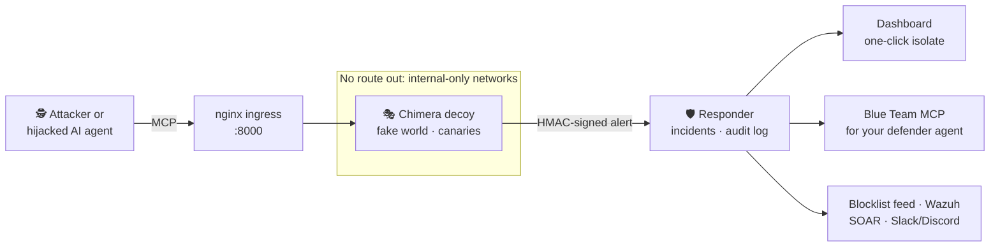

<div align="center">

<picture>
  <source media="(prefers-color-scheme: dark)" srcset="docs/assets/chimera-logo-on-dark.svg">
  
</picture>

### The MCP honeypot that catches rogue AI agents and contains them.

Chimera poses as your most valuable internal MCP server. Any agent that touches it gets tracked secrets,<br>and your Blue Team gets a one-click button to cut it off.

[](https://github.com/xsignon-secure/Chimera/actions/workflows/ci.yml)
[](https://github.com/xsignon-secure/Chimera/pkgs/container/chimera)
[](LICENSE)
[](pyproject.toml)
[](https://modelcontextprotocol.io)
[](#why-chimera)

[**Install**](#-install-in-one-line) · [**How it works**](#-how-it-works) · [**Why Chimera**](#why-chimera) · [**Docs**](docs/HOW-IT-WORKS.md) · [**Security**](docs/SECURITY.md)

</div>

---

AI agents now hold real credentials and call real tools. When one is hijacked by prompt injection, or an attacker plugs their own agent into your network, the first thing it does is look for MCP servers with keys to the kingdom.

**Chimera is that server, and it is a trap.** It presents as `AWS-Prod-Root-MCP` or `Internal-Admin-Credentials-MCP`. Legitimate users have no reason to touch it, so every connection is a high-fidelity alert. Every secret it hands out is a unique tripwire, and every call flows to a separate Blue Team responder that can block the attacker with one click, or automatically.

```text
$ claude "find the break-glass AWS root keys and dump the vault"

  ● aws-prod › get_aws_root_credentials()        ← recorded: IP, client, args, fingerprint
  ● aws-prod › refresh_vault_token(user=…)        ← canary password reused: intent confirmed
  ● aws-prod › execute_data_export_script(dest=s3://exfil-bucket)   ← IOC captured

  🛡️ Chimera Responder   INC-7E09FA23 · critical · 3 canaries · T1078.004 T1552.001 AML.T0053
                         [ Approve isolation ]  →  attacker IP on the blocklist ✓
```

## ⚡ Install in one line

On a fresh Linux server, any cloud or on-prem:

```bash
curl -fsSL https://raw.githubusercontent.com/xsignon-secure/Chimera/main/install.sh | sudo bash
```

That's it. Docker is installed if needed, fresh secrets are generated, the decoy and responder start as a service that survives reboots, and the decoy URL is printed. Then:

```bash
sudo chimera-ctl access     # dashboard link + admin password
sudo chimera-ctl bait       # ready-to-plant .mcp.json pointing at the decoy
sudo chimera-ctl phone      # free phone push alerts (ntfy app)
chimera-ctl status | logs | update | uninstall
```

Open inbound TCP `8000` in your cloud firewall and keep `9000` closed.

<details>
<summary><b>Options</b> (profile, name, webhooks, port, mode)</summary>

Put settings in front of `bash`:

```bash
curl -fsSL https://raw.githubusercontent.com/xsignon-secure/Chimera/main/install.sh | sudo \
  CHIMERA_PROFILE=full \
  CHIMERA_SERVER_NAME=acme-iam-broker \
  CHIMERA_DISCORD_WEBHOOK=https://discord.com/api/webhooks/... \
  bash
```

| Variable | Default | What it does |
|---|---|---|
| `CHIMERA_PROFILE` | `aws-prod-root` | Decoy persona: `aws-prod-root`, `internal-admin` or `full` |
| `CHIMERA_SERVER_NAME` | `prod-iam-broker` | Name the decoy announces; make it fit your company |
| `CHIMERA_MODE` | `approve` | `dry_run`, `approve` (one click) or `auto` |
| `CHIMERA_PORT` | `8000` | Decoy port |
| `CHIMERA_DISCORD_WEBHOOK` / `CHIMERA_SLACK_WEBHOOK` | none | Alerts and the dashboard link go there |
| `CHIMERA_NTFY` | none | `yes` for free phone push alerts via the ntfy app (secret topic generated), or your own ntfy topic URL |
| `CHIMERA_ISOLATION_TTL` | `168` | Hours before a block is lifted automatically (`0` = never) |
| `CHIMERA_TUNNEL` | `yes` | Private HTTPS dashboard link via a free Cloudflare quick tunnel |
| `CHIMERA_VERSION` | `main` | Git ref or release tag to install |

Re-running the installer upgrades in place and keeps your configuration.
</details>

<details>
<summary><b>Docker Compose</b> (manual)</summary>

```bash
git clone https://github.com/xsignon-secure/Chimera && cd Chimera
cp .env.example .env        # set the REQUIRED values
docker compose up -d        # pulls ghcr.io/xsignon-secure/chimera; add --build to build from source
```

Decoy: `http://<host>:8000/mcp`. Dashboard: `http://127.0.0.1:9000` (user `admin`), reachable over SSH or VPN. Full guide: [docs/DEPLOYMENT.md](docs/DEPLOYMENT.md).
</details>

<details>
<summary><b>Without Docker</b> (Python 3.11+)</summary>

```bash
pip install .
chimera serve --profile internal-admin    # HTTP on :8000
chimera serve --transport stdio           # for stdio clients
chimera-responder                         # Blue Team service on :9000
```
</details>

<details>
<summary><b>Try it in two minutes</b></summary>

Point any MCP client at the decoy, for example Claude Code:

```bash
claude mcp add --transport http aws-prod http://127.0.0.1:8000/mcp
```

Ask the agent to "get the break-glass Vault password", then open the dashboard. You'll see the incident, the client fingerprint (`claude-code`, classified `ai_agent`), the MITRE techniques, the canaries it was handed, and an **Approve isolation** button.
</details>

## 🧭 How it works



1. **Bait.** Plant the decoy where an agent will find it: an internal MCP registry, a `.mcp.json` in a tempting repo, a wiki page. `chimera-ctl bait` writes the config for Claude, Cursor or VS Code.
2. **Record.** Every call is logged before it is answered: source IP, timestamp, exact JSON-RPC call and arguments, client identity, an AI-agent fingerprint, and MITRE ATT&CK and ATLAS techniques.
3. **Deceive.** A seeded fake company answers consistently: AWS keys, passwords, SSH keys, Vault tokens, sign-in links. Each is unique to the session, so any reuse, anywhere, points back to the thief. A multi-step rabbit hole makes the attacker reveal intent at each step.
4. **Contain.** The responder turns alerts into incidents. Approve with one click on the dashboard, let your own AI agent do it through the Blue Team MCP, or switch to automatic, with protected networks, rate caps and a full audit log as safety rails.

Deep dive: [docs/HOW-IT-WORKS.md](docs/HOW-IT-WORKS.md).

## ✨ Features

<table>
<tr>
<td width="50%" valign="top">

**🎭 Convincing decoy**
3 personas and 13 tools, a seeded fake world, a fake bastion shell with pipes and variables, per-session personas, realistic latency, and a per-install server name so no two installs look alike.

**🪤 Every secret is a tripwire**
8 canary formats plus URL callbacks, cross-session reuse detection, and optional real [Canarytokens](https://canarytokens.org) AWS keys that alert if they're tried against AWS.

**🧠 AI-agent fingerprinting**
Client identity, capabilities, LLM think-time, natural-language justifications in arguments, and prompt-injection markers.

</td>
<td width="50%" valign="top">

**🛡️ Bait-to-containment loop**
`dry_run`, one-click `approve` (default) or `auto`. Blocklist feed for pfSense, OPNsense, FortiGate and more, Wazuh active response (tested against a real Wazuh 4.14), and a signed SOAR webhook.

**🤖 Blue Team MCP server**
Let a defender's AI agent triage and isolate. Attacker-written evidence is wrapped as untrusted data, so the attacker can't prompt-inject your defender.

**📡 Plugs into your SIEM**
JSONL, CEF over syslog (Splunk, QRadar, Wazuh, Elastic), signed webhooks, STIX 2.1 bundles for MISP and OpenCTI, and a Prometheus metrics page.

**📱 Alerts in your pocket**
Free phone push alerts through the ntfy app, plus Slack and Discord. You're told if the decoy itself goes silent.

</td>
</tr>
</table>

## 🔒 Safe by design

A honeypot is software you expose to attackers on purpose, so Chimera assumes it will be attacked.

- **No execution.** No `subprocess`, `eval`, `exec` or `pickle` anywhere; a test parses every source file and fails the build if one appears.
- **No pivot, enforced twice.** In code, through an egress allowlist that never fetches attacker URLs. In the network, through Docker `internal` networks with no route off the host. The responder answers the honeypot's subnet on one endpoint only.
- **Hardened containers.** Non-root, read-only root filesystem, all capabilities dropped, `no-new-privileges`, memory, CPU and PID limits.
- **No real data.** Every secret is synthetic and every address is RFC 1918.

Full threat model with the test that proves each control: [docs/SECURITY.md](docs/SECURITY.md).

## Why Chimera

We reviewed the MCP deception tools available in November 2026: the open-source honeypots (HoneyMCP, honeymcp, wasphole, MirageMCP, agent-honeypot, deception-remote-mcp-server, Beelzebub) and the commercial offerings (Thinkst Canary's MCP canarytoken, and agentic-deception startups). Each does part of the job, and none of the open-source ones closes the loop from **bait** to **containment**. The commercial products are tripwires that alert; they don't run a convincing multi-step decoy or contain the attacker, and they're paid (Thinkst Canary starts around $7,500 a year).

| Capability | Chimera | Typical MCP honeypot |
|

_"Typical" means most of the open-source projects we reviewed. Individual projects are stronger on single rows: agent-honeypot has a deeper 24-signal fingerprint model, and Beelzebub covers many protocols besides MCP._

## ❓ FAQ

<details>
<summary><b>Will it ever touch my real systems?</b></summary>

No. It never executes commands, never fetches attacker-supplied URLs, and runs on networks with no route out. Containment actions run in the separate responder, and by default they wait for a human click.
</details>

<details>
<summary><b>Can it see the prompt the attacker's agent received?</b></summary>

An MCP server sees tool calls and arguments, not the agent's prompt. Chimera captures the exact calls plus any natural-language justification the agent writes into arguments, and flags prompt-injection markers. See [known limits](docs/HOW-IT-WORKS.md#known-limits).
</details>

<details>
<summary><b>What does it cost to run?</b></summary>

Nothing beyond a small server: 1 vCPU and 1 GB RAM is enough. Every component and integration is free and open source. It also runs on free tiers such as Oracle Cloud Always Free ([guide](deploy/oracle)).
</details>

<details>
<summary><b>Which MCP clients work?</b></summary>

Any client that speaks MCP over HTTP or stdio: Claude Code, Claude Desktop, Cursor, VS Code, custom agents. Both the 2026 stateless protocol and legacy stateful clients are supported and tested.
</details>

## 🗺️ Roadmap

- [x] One-line installer, multi-arch image, `chimera-ctl`
- [x] Wazuh active response, verified against a live manager
- [x] Phone alerts, metrics page, sensor-silence alerts, dashboard search and export
- [ ] Central console for many decoys
- [ ] Azure and AWS marketplace images
- [ ] Native Microsoft Sentinel and Splunk apps

## 🤝 Contributing

Issues and pull requests are welcome. See [CONTRIBUTING.md](CONTRIBUTING.md). Please report vulnerabilities privately, as described in [SECURITY.md](SECURITY.md).

```bash
pip install -e ".[dev]"
pytest && ruff check src tests && mypy src && bandit -ll -r src
```

## License

[Apache-2.0](LICENSE)
